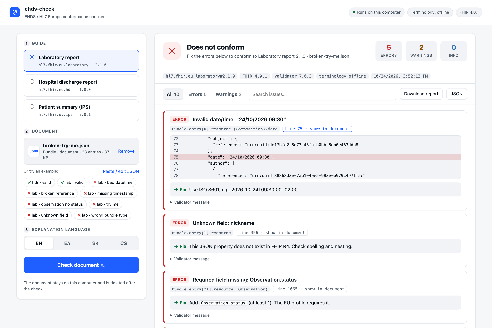
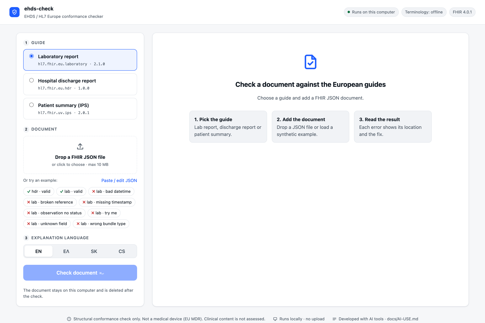
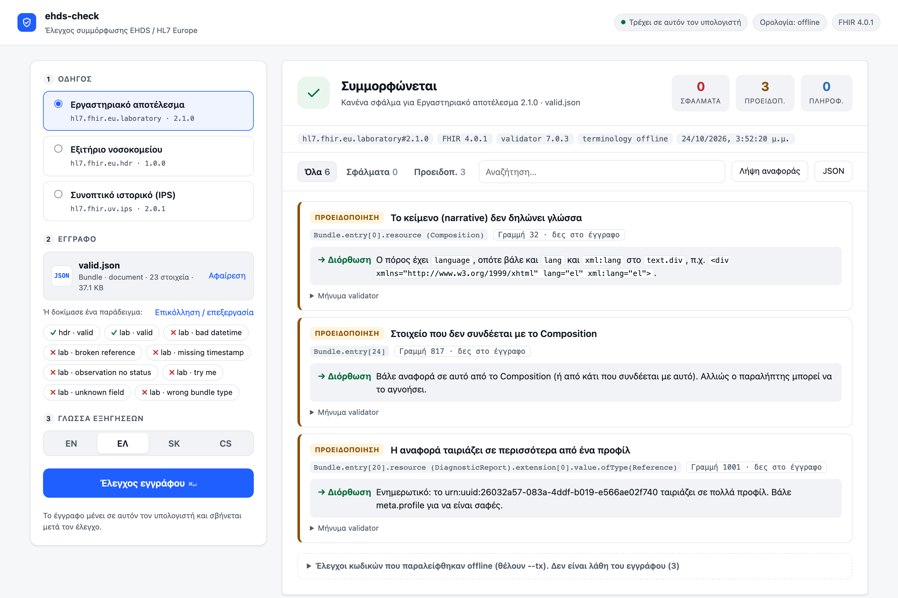
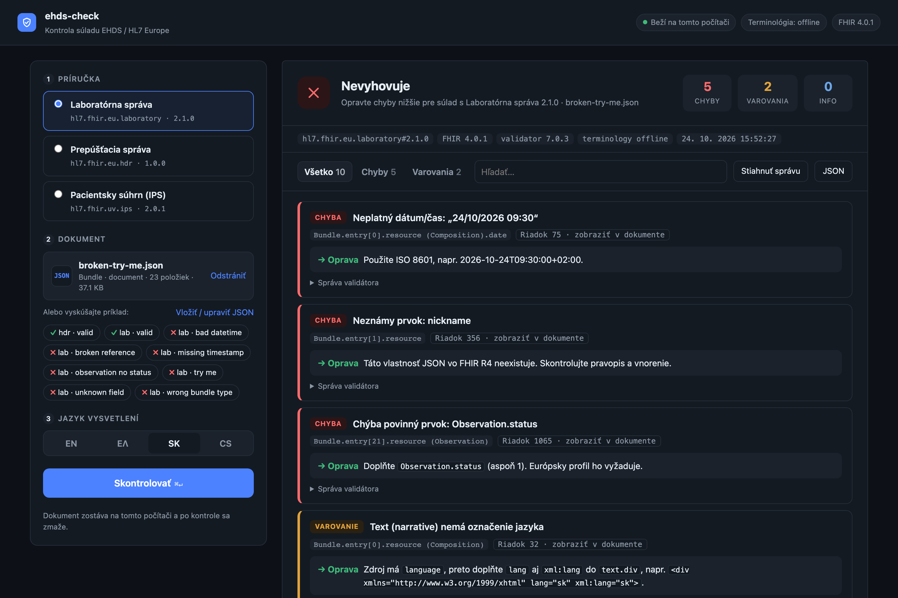

# ehds-check

Conformance checker for European Health Data Space (EHDS) documents.

Checks HL7 FHIR documents against the HL7 Europe implementation guides.
Each error comes with an explanation and a fix in English, Greek, Slovak or Czech.
Uses the official HL7 FHIR Validator. Runs on your computer; nothing is uploaded.



**Contents:** [Who it is for](#who-it-is-for) · [Quick start](#quick-start) ·
[Web UI](#web-ui) · [Command line](#command-line) · [CI](#ci-github-actions) ·
[Test documents](#test-documents) · [Guides](#supported-guides-pinned) ·
[Privacy](#privacy) · [Development](#development) · [Docs](#documentation) · [License](#license)

## Who it is for

Developers and IT teams that build software producing FHIR documents:
laboratory systems, hospital and practice software, integrators.
Clinicians do not use it; it checks the files their software sends.

| You have | ehds-check tells you |
|---|---|
| A FHIR JSON lab report, discharge report or patient summary | Whether it conforms to the pinned HL7 Europe guide |
| An error from the validator | What it means, where it is (path + line), how to fix it |
| A CI pipeline | Pass/fail per build, JUnit report, exit code |

## Quick start

Needs Node 20+ and Java 17+.

```bash
git clone https://github.com/AgiannidisMD/ehds-check && cd ehds-check && npm link
ehds-check setup      # downloads the HL7 validator (~200 MB, once, sha256-checked)
ehds-check serve      # opens the web UI on http://127.0.0.1:8787
```

The first check per guide downloads the FHIR packages (~20–30 s).

## Web UI

`ehds-check serve` starts a page on `127.0.0.1` (not reachable from other computers).

1. **Guide:** laboratory report, hospital discharge report or patient summary (IPS).
2. **Document:** drop a FHIR JSON file, paste it, or click a bundled example.
3. **Language:** EN, ΕΛ, SK, CS. The page and the explanations switch together.
4. **Check document** (or ⌘/Ctrl + Enter).

The result shows pass/fail, counts, and one card per issue with the path,
the line (click to see the JSON around it) and the fix. Follow-on errors and
code checks skipped offline are grouped at the end. Reports download as HTML or JSON.

| Start | Valid document (Greek) | Dark mode (Slovak) |
|---|---|---|
|  |  |  |

## Command line

```bash
ehds-check my-report.json --ig lab --lang el
ehds-check out/*.json --ig hdr --format html --out report.html
ehds-check out/*.json --format junit --out junit.xml
```

```
$ ehds-check examples/lab/broken-try-me.json --min error
ehds-check · hl7.fhir.eu.laboratory#2.1.0 · FHIR 4.0.1 · validator 7.0.3 · tx offline

✗ FAIL  examples/lab/broken-try-me.json  (5 errors, 0 warnings)
  ERROR Invalid date/time: "24/10/2026 09:30"
        at Bundle.entry[0].resource (Composition).date line 75
        → Use ISO 8601, e.g. 2026-10-24T09:30:00+02:00.
  ERROR Unknown field: nickname
        at Bundle.entry[1].resource line 356
        → This JSON property does not exist in FHIR R4. Check spelling and nesting.
  ERROR Required field missing: Observation.status
        at Bundle.entry[21].resource (Observation) line 1065
        → Add `Observation.status` (at least 1). The EU profile requires it.
  ...
```

| Option | Values | Default |
|---|---|---|
| `--ig` | `lab`, `hdr`, `ips` | `lab` |
| `--lang` | `en`, `el`, `sk`, `cs` | `en` |
| `--format` | `text`, `json`, `html`, `junit` | `text` |
| `--out` | file path | stdout |
| `--min` | `error`, `warning`, `information` | `warning` |
| `--tx` | terminology server URL (sends codes only) | offline |
| `--verbose` | show validator log | off |

Exit code: `0` pass · `1` conformance errors · `2` tool error.

## CI (GitHub Actions)

```yaml
- uses: AgiannidisMD/ehds-check@main
  with:
    files: fhir-out/*.json   # files or globs, space separated
    ig: lab                  # lab | hdr | ips
    lang: el                 # en | el | sk | cs
```

The job fails on conformance errors and writes `ehds-check-junit.xml`.
Validator and FHIR packages are cached between runs.

## Test documents

All synthetic. No real patient data.

| File | Expected result |
|---|---|
| `examples/lab/valid.json` | ✓ conforms |
| `examples/lab/broken-try-me.json` | ✗ 3 errors: date format, unknown field `nickname`, missing `Observation.status` |
| `examples/lab/broken-*.json` | ✗ fails; the file name says which error was added |
| `examples/hdr/valid.json` | ✓ conforms |

## Supported guides (pinned)

| `--ig` | Guide | Version |
|---|---|---|
| `lab` | HL7 Europe Laboratory Report | 2.1.0 |
| `hdr` | HL7 Europe Hospital Discharge Report | 1.0.0 |
| `ips` | International Patient Summary | 2.0.1 |

FHIR R4 (4.0.1), HL7 FHIR Validator 7.0.3. Each report lists the versions used.

## Privacy

- Runs on your machine. Documents are not uploaded.
- Terminology checks are off by default (`-tx n/a`). `--tx https://tx.fhir.org/r4`
  sends codes (not documents) to that server.
- The web UI listens on `127.0.0.1` only, rejects cross-site requests and deletes
  each document after checking it.

## Not a medical device

ehds-check checks structure and conformance only. It does not interpret clinical content.

## Development

```bash
npm test                    # unit tests, no Java needed
npm run test:integration    # runs the real validator on examples/
npm run fixtures            # rebuild examples/ from the official CC0 IG examples
npm run ig-watch            # newer guide versions published? (exit 10 = yes)
```

Examples in `examples/` are derived from the official CC0-licensed HL7 Europe IG
examples, with person names and identifiers replaced by synthetic values.

## Documentation

| Document | Content |
|---|---|
| [docs/WORKFLOW.md](docs/WORKFLOW.md) | How changes are made, tested and released |
| [docs/I18N-REVIEW.md](docs/I18N-REVIEW.md) | Translation status per language, how to add a message |
| [docs/AI-USE.md](docs/AI-USE.md) | How generative AI is used in this project |
| [action.yml](action.yml) | GitHub Action inputs |

## GenAI disclosure

Code and docs are written with generative AI tools and reviewed by the owner. See [docs/AI-USE.md](docs/AI-USE.md).

---
## License

Apache License 2.0. See [LICENSE](LICENSE) and [NOTICE](NOTICE).
The HL7 FHIR Validator is downloaded separately and has its own licence (Apache 2.0).

---
A product of STOLOSDIGITAL (stolosofficial s. r. o., Slovakia).
